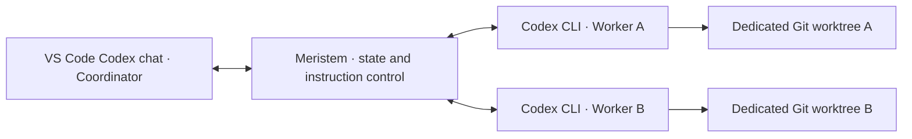

# Meristem

[日本語](README.md) | **English**

**An experimental Windows tool for assigning work to multiple independent Codex CLI chats from your usual VS Code Codex chat, with reporting, stop controls, and Git integration.**

In this README, the **parent chat (Coordinator)** coordinates work, and each **child chat (Worker)** handles an implementation assignment. The terms **Coordinator** and **Worker** are used below. A Worker is a Codex CLI chat with its own conversation history, distinct from internal subagents that a Coordinator or Worker may use.

Keep the standard Codex extension as the Coordinator and monitor Workers in VS Code's bottom terminal panel. Meristem supports sequential stages and up to two Workers running in parallel.

> This is an experimental tool for developers. It has been tested in dedicated VS Code profiles; everyday use in your normal profile and reliable operation across a broad range of environments are not guaranteed.

## Features

| Feature | What it does |
|---|---|
| Stage assignments | Reads dependencies and scope from a Markdown plan and assigns separate Git worktrees and branches. |
| Sequential and parallel work | Runs dependent stages in order, with up to two Workers for stages whose scopes and shared resources do not conflict. |
| Corrections and handoffs | Lets the Coordinator choose between a correction using the same conversation history and a handoff to a fresh Worker. |
| Coordinator wake after reports | When enabled, resumes the Coordinator after checking saved reports and completion state. Routine monitoring makes no model calls. |
| Questions and human approval | Lets the Coordinator handle Worker questions while humans decide supported approval requests through the actual approval UI. |
| Git acceptance | Distinguishes Worker candidate SHAs from integrated SHAs and checks validation results and actual Git state before releasing the next stage. |
| Stop and retain work | Confirms owned process termination and retains working files, branches, and reports. Instructions with unknown delivery outcomes are not automatically resent. |

## How it works



1. A human checks the selected Coordinator chat, plan, repository, and branch, then authorizes the run.
2. The Coordinator assigns work. Each Worker implements and validates changes in its own worktree, then leaves its results and report.
3. The Coordinator checks reports, normal turn completion, outstanding requests, process cleanup, and Git results.
4. The Coordinator accepts candidates, integrates them, and validates the integrated result before releasing dependent stages.

Worker terminals are **read-only**, showing state and a limited event log. Typing or pasting into them does not send instructions to a Worker. See the [coordination skill](skills/codex-chat-coordination/SKILL.md) and [plan and report contract](skills/codex-chat-coordination/references/plan-and-report.md) for Coordinator and Worker procedures.

## Validation status

The [acceptance record](docs/validation/chat-control/CC-07.md) and [continuation record](docs/validation/chat-control/CC-07-continuation.md), dated November 16, 2026, document the following in dedicated environments:

- Sequential work with real Codex and VS Code, same-history report corrections, handoffs to fresh Workers, and question/answer handling.
- Two Workers working in parallel, integration of pinned candidates, and correction of inconsistencies detected after integration.
- Stop, reconciliation, and work retention when closing a Worker tab, stopping the Coordinator, or reloading VS Code.
- Installation and configuration restoration in dedicated environments, plus pushing and reading back integrated results on a private GitHub test branch.
- Successful automated validation: 234 tests (39 native/spike, 181 control, 14 terminal), type checks, and builds.

These results apply to the recorded environments and scenarios. Failed attempts and unverified items are retained as well. They do not establish normal-profile installation or compatibility with other environments.

## Requirements

| Component | Requirement |
|---|---|
| OS | Windows x64 |
| Node.js | 24.22.1 or later for source builds; bundled in the Windows x64 ZIP. |
| VS Code | 1.90 or later. Live runs also require the official Codex extension and a dedicated profile. |
| Git | Available on the command line; worktrees and branches are used. |
| Native build | Source builds require the Windows .NET Framework x64 compiler (`csc.exe`). The ZIP requires no compilation. PowerShell scripts must be permitted to run. |
| Live-model authentication | A dedicated Codex home authenticated through the official ChatGPT login flow. |

Live validation used Codex `0.169.0-alpha.11.1` and Node.js `24.22.1`. Absolute paths and SHA-256 hashes pin the Codex/Node executables and entry points. Compatibility with other Codex versions is not guaranteed; changing only a hash to enable a newer version is not a supported upgrade procedure.

## Getting started

Prebuilt packages are available from the [v0.1.0 release](https://github.com/takikomirice/meristem/releases/tag/v0.1.0). The Windows x64 ZIP includes the application, helper extension, Node.js, and npm dependencies; no compilation or separate Node.js installation is needed. See the [package setup guide](docs/releases/INSTALL.en.md). Dedicated configuration, official login, and human authorization are still required.

The following steps are for building and validating from source.

### 1. Build and validate without model calls

Run from the repository root:

```powershell
npm ci --ignore-scripts
npm run verify
```

`verify` builds the native executables, TypeScript, and helper extension, then runs tests using fake Codex/MCP clients and local Git. It does not connect to real models or GitHub. This step does not install anything into VS Code or launch real-model Workers.

### 2. Connect real Codex in a dedicated environment

A live setup requires a dedicated profile, official authentication, a pinned Codex runtime, an explicit plan and Git scope, and prepared configuration files. There is currently no one-command installer for your normal environment.

The [installation, operation, and validation reference](docs/chat-control-reference.ja.md) (Japanese) covers VSIX packaging, example installation settings, run authorization, startup, stop, uninstall, and live-test runners. Set a model-send budget before a live trial and use a dedicated environment with human approval. Installing into your normal profile is a separate, explicit decision.

## Stop and recovery

| Action | Behavior |
|---|---|
| Stop a Worker | Use the Coordinator's `stop_worker`, close a running Worker tab, or select `Meristem: Stop Current Worker`. This blocks new instructions and automatic Coordinator wake, and stops that Worker. A sibling may still finish its current turn and report. |
| Stop the run | Use the Coordinator's `stop_run`, the Coordinator's normal UI stop control, or the local CLI's `stop` command. This stops all managed Workers. |
| Check status | Use the Coordinator's `get_status` or the local CLI's `status` command. A disconnected run requires reconciliation as `needs_reconcile`; disconnection is not treated as a successful stop. |
| Restore configuration | Confirm the run has stopped and the dedicated window has closed, then uninstall. Settings changed by the user after installation are retained. |

Hiding a panel or switching tabs does not stop work. Closing an already-completed tab only closes its display. Restarting VS Code or the broker does not automatically restore Workers: reconciliation, renewed human confirmation, and explicit resume are required. Stop and uninstall do not delete working files, branches, the state database, or validation records.

## Limitations

- Windows only; macOS and Linux have not been validated.
- No direct Worker input, interactive TUI, or full conversation transcript in Worker terminals.
- Worker approval handling is limited to selected local MCP requests and fixed Git paths. Arbitrary command, network, and authentication requests are unsupported.
- No continued execution or automatic restoration after VS Code exits.
- Some earlier startup and disconnect failures remain unexplained. Not every observed failure has been resolved.
- Everyday use in a normal profile, Marketplace distribution, and automatic startup registration are outside the validated and provided scope.

## Documentation and code

| Purpose | Reference |
|---|---|
| Detailed installation, startup, stop, and restoration | [Operational reference](docs/chat-control-reference.ja.md) (Japanese) |
| Coordinator and Worker procedures | [Coordination skill](skills/codex-chat-coordination/SKILL.md) |
| Markdown plans and structured reports | [Format reference](skills/codex-chat-coordination/references/plan-and-report.md) |
| Latest acceptance results and limitations | [CC-07](docs/validation/chat-control/CC-07.md) and [continuation](docs/validation/chat-control/CC-07-continuation.md) (Japanese) |
| Design and staged implementation plan | [Design](docs/superpowers/specs/2026-11-15-codex-chat-control-design.md) and [implementation plan](docs/superpowers/plans/2026-11-15-codex-chat-control-implementation.md) (Japanese) |
| Broker, state, MCP, and Git validation | [`src/`](src/) |
| Windows process management and relay | [`native/`](native/) |
| VS Code Worker terminals and approval UI | [`extension/`](extension/) |
| Automated validation and live-test runners | [`test/`](test/) |

Detailed setup and validation documents are primarily in Japanese. See [README.md](README.md) for the Japanese overview.

## License

Original project code and documentation are available under the [MIT License](LICENSE). Retain the copyright notice and license text. See [Third-party notices](THIRD_PARTY_NOTICES.md) for dependency licenses.

The [publication preparation record](docs/publication-preparation.md) (Japanese) describes excluded logs, redacted validation records, the review scope, and the treatment of Git history. See the [v0.1.0 release notes](docs/releases/v0.1.0.md) for package contents and limitations.
