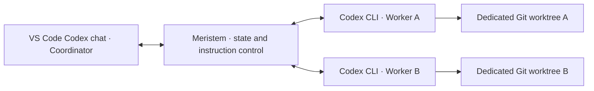

# Meristem

[日本語](README.md) | **English**

**An experimental Windows tool for assigning work to multiple independent Codex CLI chats from your usual VS Code Codex chat, with reporting, stop controls, and Git integration.**

In this README, the **parent chat (Coordinator)** coordinates work, and each **child chat (Worker)** handles an implementation assignment. The terms **Coordinator** and **Worker** are used below. A Worker is a Codex CLI chat with its own conversation history, distinct from internal subagents that a Coordinator or Worker may use.

Keep the standard Codex extension as the Coordinator and monitor Workers in VS Code's bottom terminal panel. Meristem supports sequential stages and parallel work with two Workers by default. Plan version 2 allows human-approved expansion.

> This is an experimental tool for developers. It has been tested in dedicated VS Code profiles; everyday use in your normal profile and reliable operation across a broad range of environments are not guaranteed.

## Using the official CLI in the development build

Open `powershell.exe` from the Windows Run dialog and change to the repository named by your version 2 plan. With the official Codex CLI on PATH and signed in to ChatGPT, run a command such as `& 'C:\Tools\Meristem\scripts\meristem.ps1' start` using the location of your Meristem build. On first use it detects the plan and opens the official TUI in a separate console. The original PowerShell stays open for management. For approvals, Meristem checks that the interactive shell was launched by Explorer, directly or through a supported Windows Terminal process.

Ask the conversation you want as Coordinator to start Meristem. In the original PowerShell, enter `start` to review the repository, Git destination, and Worker limit. Use `status` for progress, `usage` for rate limits, `answer` for consultations and permission requests, and `stop` to stop Workers and see their termination results. After closing the terminal, use `meristem.ps1 resume` to select the saved run.

Live acceptance of Worker reporting and automatic continuation of the Coordinator is pending. [P5 implementation and validation](docs/superpowers/plans/2026-11-19-meristem-v030.md)

## Features

MC-01 adds database schema 6 and persistence contracts for decisions, task holds, parallelism approvals, and plan revisions. Plan version 2 accepts `run.execution_limits` (`maxWakeTurns`, `maxCorrectionsPerTask`), task `display_name`, and `agent.permissionProfileId`. MC-05 connects execution limits. Omitted/null means unlimited, and positive integers impose finite budgets. Display names contain 1–128 characters after trimming. Version 1 also accepts limits through the dedicated config's `executionLimits`. Human resolution requires a trusted adapter that binds the response to its form and answer. Restart invalidates old forms.

MC-03/04 connect the MCP consultation inbox and human choice forms with task holds, execution-slot reuse after confirmed cleanup, and explicit resume. Saving an answer never starts work: the Coordinator checks the plan, answer, Git and stop evidence before assigning a new Worker. See the [operations reference (Japanese)](docs/chat-control-reference.ja.md) for the contract and validation scope. These integration checks use fixtures; they do not establish new live-model or real-UI acceptance.

MC-05 adds `retire_worker` to stop one Worker while independent work continues after confirmed cleanup. Tasks, worktrees and logs remain available. The extension adds **Meristem: Retire Current Worker (Keep Run Active)** and **Meristem: Stop All Workers**; the latter works without a responsive Coordinator model. Deleting a running terminal still blocks new dispatches and Coordinator wakes as before.

MC-06 separates version 2 `run.max_parallel` (requested capacity) from the run-local human-approved ceiling. Before approval, at most two Workers can run. Integration pins N candidates, checks the final SHA, and accepts check batches of up to 32. [MC-06 evidence](docs/validation/chat-control/MC-06.md) covers local Git and deterministic fixtures; new real-model and UI acceptance is not run.

MC-08 lets a human review the exact diff and affected tasks before changing an active plan's dependencies, required checks or Worker settings. The Coordinator applies the approved diff and explicitly reassigns the affected tasks. See the [operations reference (Japanese)](docs/chat-control-reference.ja.md#mc-08-人の合意に基づく工程表改訂).

Version 2 plans support `workspace` for implementation and `read-only` for investigation or review. A read-only Worker reports the examined commit and the result and evidence for each required check. The Coordinator accepts the report to release dependent tasks. The RunPermit specifies the allowed profiles. [Plan and report contract](skills/codex-chat-coordination/references/plan-and-report.md#report)

A managed Worker terminal normally opens with three lines showing the assignment and state, model, and permissions. When the applied model or reasoning effort changes within the same chat, the terminal shows the previous and new values on one line. Updates show command, edit, and test activity, consultation recipients, continuing and held task scopes, and confirmed exits. The Command Palette provides a Worker list, a details view, and a rename action. The initial name comes from plan version 2's `display_name`. [Terminal operations (Japanese)](docs/chat-control-reference.ja.md#管理ターミナルの表示と操作)

MC-10 lets you select saved Worker history from VS Code, the CLI, or the Coordinator's MCP tools. Preparing a restart verifies the recorded exit, delivery state, and Git worktree before handing off to a fresh Codex thread with the current task settings. [History and restart instructions (Japanese)](docs/chat-control-reference.ja.md#ワーカーの履歴と再開準備)

Set `model_routing` on a task in a version 2 plan to record the Worker's acknowledged model and reasoning effort alongside initial acceptance and completion after handoff. With `run.worker_model_policy`, an evidence-backed handoff can select the next setting from a human-approved sequence. [Model outcomes and switching (Japanese)](docs/chat-control-reference.ja.md#ワーカーのモデル実績)

Choose comparable tasks and set `pin_initial: true` to fix each trial's setting before work begins. Use `routing-summary` to export outcomes from confirmed stopped runs, then bind the summary to the next run's approval. In `learned` mode, each setting needs at least five comparable first attempts before a candidate can replace the plan's choice. Approve a new run in `rules` mode to return to plan-defined initial settings. [Comparing outcomes and assigning initial Workers (Japanese)](docs/chat-control-reference.ja.md#実績を次のrunで使う)

| Feature | What it does |
|---|---|
| Stage assignments | Reads dependencies and scope from a Markdown plan and assigns separate Git worktrees and branches. |
| Sequential and parallel work | Runs dependent stages in order. Independent scopes and shared resources permit parallel work with two Workers by default, with human-approved expansion in plan version 2. |
| Corrections and handoffs | Supports corrections in a verified worktree and handoffs to a fresh Worker. Currently, choosing history continuation also starts a fresh thread to avoid inheriting old permission grants. |
| Coordinator wake after reports | When enabled, resumes the Coordinator after checking saved reports and completion state. Routine monitoring makes no model calls. |
| Questions and human approval | Lets the Coordinator handle Worker questions while humans decide supported approval requests through the actual approval UI. |
| Git acceptance | Distinguishes Worker candidate SHAs from integrated SHAs and checks validation results and actual Git state before releasing the next stage. |
| Stop and retain work | Confirms owned process termination and retains working files, branches, and reports. Instructions with unknown delivery outcomes are not automatically resent. |

## How it works



1. A human checks the selected Coordinator chat, plan, repository, and branch, then authorizes the run.
2. The Coordinator assigns work. Each Worker implements and validates changes in its own worktree, then leaves its results and report.
3. The Coordinator checks reports, normal turn completion, outstanding requests, process cleanup, and Git results.
4. The Coordinator accepts candidates, integrates them, and validates the integrated result before releasing dependent stages.

Worker terminals are **read-only**, showing state and a limited event log. Typing or pasting into them does not send instructions to a Worker. See the [coordination skill](skills/codex-chat-coordination/SKILL.md) and [plan and report contract](skills/codex-chat-coordination/references/plan-and-report.md) for Coordinator and Worker procedures.

## Validation status

The [MC-12 acceptance record (Japanese)](docs/validation/chat-control/worker-coordination-acceptance.md) covers version 2 coordination and Worker model routing, including the local Git checks and the observations from the dedicated Windows environment.

See the [MC-02 compatibility record](docs/validation/chat-control/worker-coordination-compatibility.md) (Japanese) for question, approval-reviewer, and history API checks and rerun instructions. It distinguishes fixture coverage, live observations, and unverified behavior.

The [acceptance record](docs/validation/chat-control/CC-07.md) and [continuation record](docs/validation/chat-control/CC-07-continuation.md), dated November 16, 2026, document the following in dedicated environments:

- Sequential work with real Codex and VS Code, same-history report corrections, handoffs to fresh Workers, and question/answer handling.
- Two Workers working in parallel, integration of pinned candidates, and correction of inconsistencies detected after integration.
- Stop, reconciliation, and work retention when closing a Worker tab, stopping the Coordinator, or reloading VS Code.
- Installation and configuration restoration in dedicated environments, plus pushing and reading back integrated results on a private GitHub test branch.
- Successful automated validation: 234 tests (39 native/spike, 181 control, 14 terminal), type checks, and builds.

These results apply to the recorded environments and scenarios. Failed attempts and unverified items are retained as well. They do not establish normal-profile installation or compatibility with other environments.

## Requirements

| Component | Requirement |
|---|---|
| OS | Windows x64 |
| Node.js | 24.22.1 or later for source builds; bundled in the Windows x64 ZIP. |
| VS Code | 1.90 or later. Live runs also require the official Codex extension and a dedicated profile. |
| Git | Available on the command line; worktrees and branches are used. |
| Native build | Source builds require the Windows .NET Framework x64 compiler (`csc.exe`). The ZIP requires no compilation. PowerShell scripts must be permitted to run. |
| Live-model authentication | A dedicated Codex home authenticated through the official ChatGPT login flow. |

Live validation used Codex `0.169.0-alpha.11.1` and Node.js `24.22.1`. Absolute paths and SHA-256 hashes pin the Codex/Node executables and entry points. Compatibility with other Codex versions is not guaranteed; changing only a hash to enable a newer version is not a supported upgrade procedure.

## Getting started

Prebuilt packages are available from the [v0.2.0 release](https://github.com/takikomirice/meristem/releases/tag/v0.2.0). The Windows x64 ZIP includes the application, helper extension, Node.js, and npm dependencies; no compilation or separate Node.js installation is needed. See the [package setup guide](docs/releases/INSTALL.en.md). Dedicated configuration, official login, and human authorization are still required.

The following steps are for building and validating from source.

### 1. Build and validate without model calls

Run from the repository root:

```powershell
npm ci --ignore-scripts
npm run verify
```

`verify` builds the native executables, TypeScript, and helper extension, then runs tests using fake Codex/MCP clients and local Git. It does not connect to real models or GitHub. This step does not install anything into VS Code or launch real-model Workers.

The [development environment guide (DE-01–06, Japanese)](docs/development-environment.ja.md) covers read-only inspection, immutable build snapshots, run configuration generation, exclusive environment leases, and dedicated run launch, stop, and restoration. After building, use `npm run development -- <action>` to run related logic tests or switch to a new snapshot after confirmed shutdown. Explicit bounded sandbox probes and development cycle records with a zero model-turn budget are also available. See the [DE-05 validation record](docs/validation/chat-control/development-environment-first.md) for live observations and limitations, and the [DE-06 record](docs/validation/chat-control/DE-06.md) for regression results, completion criteria, and the MC-03 handoff.

### 2. Connect real Codex in a dedicated environment

A live setup requires a dedicated profile, official authentication, a pinned Codex runtime, an explicit plan and Git scope, and prepared configuration files. There is currently no one-command installer for your normal environment.

The [installation, operation, and validation reference](docs/chat-control-reference.ja.md) (Japanese) covers VSIX packaging, example installation settings, run authorization, startup, stop, uninstall, and live-test runners. Set a model-send budget before a live trial and use a dedicated environment with human approval. Installing into your normal profile is a separate, explicit decision.

## Stop and recovery

| Action | Behavior |
|---|---|
| Stop a Worker | Use the Coordinator's `stop_worker`, close a running Worker tab, or select `Meristem: Stop Current Worker`. This blocks new instructions and automatic Coordinator wake, and stops that Worker. A sibling may still finish its current turn and report. |
| Stop the run | Use the Coordinator's `stop_run`, the Coordinator's normal UI stop control, or the local CLI's `stop` command. This stops all managed Workers. |
| Check status | Use the Coordinator's `get_status` or the local CLI's `status` command. A disconnected run requires reconciliation as `needs_reconcile`; disconnection is not treated as a successful stop. |
| Restore configuration | Confirm the run has stopped and the dedicated window has closed, then uninstall. Settings changed by the user after installation are retained. |

Hiding a panel or switching tabs does not stop work. Closing an already-completed tab only closes its display. Restarting VS Code or the broker does not automatically restore Workers: reconciliation, renewed human confirmation, and explicit resume are required. Stop and uninstall do not delete working files, branches, the state database, or validation records.

## Limitations

- Windows only; macOS and Linux have not been validated.
- No direct Worker input, interactive TUI, or full conversation transcript in Worker terminals.
- Worker approval handling is limited to selected local MCP requests and fixed Git paths. Arbitrary command, network, and authentication requests are unsupported.
- No continued execution or automatic restoration after VS Code exits.
- Some earlier startup and disconnect failures remain unexplained. Not every observed failure has been resolved.
- Everyday use in a normal profile, Marketplace distribution, and automatic startup registration are outside the validated and provided scope.

## Documentation and code

| Purpose | Reference |
|---|---|
| Detailed installation, startup, stop, and restoration | [Operational reference](docs/chat-control-reference.ja.md) (Japanese) |
| Coordinator and Worker procedures | [Coordination skill](skills/codex-chat-coordination/SKILL.md) |
| Markdown plans and structured reports | [Format reference](skills/codex-chat-coordination/references/plan-and-report.md) |
| Latest acceptance results and limitations | [CC-07](docs/validation/chat-control/CC-07.md) and [continuation](docs/validation/chat-control/CC-07-continuation.md) (Japanese) |
| Design and staged implementation plan | [Design](docs/superpowers/specs/2026-11-15-codex-chat-control-design.md) and [implementation plan](docs/superpowers/plans/2026-11-15-codex-chat-control-implementation.md) (Japanese) |
| Broker, state, MCP, and Git validation | [`src/`](src/) |
| Windows process management and relay | [`native/`](native/) |
| VS Code Worker terminals and approval UI | [`extension/`](extension/) |
| Automated validation and live-test runners | [`test/`](test/) |

Detailed setup and validation documents are primarily in Japanese. See [README.md](README.md) for the Japanese overview.

## License

Original project code and documentation are available under the [MIT License](LICENSE). Retain the copyright notice and license text. See [Third-party notices](THIRD_PARTY_NOTICES.md) for dependency licenses.

The [publication preparation record](docs/publication-preparation.md) (Japanese) describes excluded logs, redacted validation records, the review scope, and the treatment of Git history. See the [v0.2.0 release notes](docs/releases/v0.2.0.md) for package contents and limitations.
