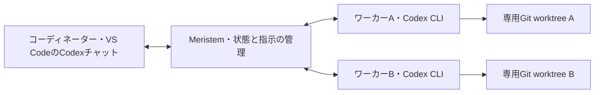

# Meristem

**日本語** | [English](README.en.md)

**VS CodeのCodexチャットから、複数の独立したCodex CLIチャットへ作業を割り当て、報告・停止・Git統合を管理するWindows向けの実験的ツールです。**

このREADMEでは、調整役を**親チャット（コーディネーター）**、実装担当を**子チャット（ワーカー）**と呼び、以降は「コーディネーター」「ワーカー」で表記します。ワーカーは独立した会話履歴を持つCodex CLIチャットで、コーディネーターやワーカーが内部で使うサブエージェントとは区別します。

普段使うCodex拡張をコーディネーターとして使い、各ワーカーの状態をVS Code下部のターミナルで確認できます。工程表に沿う直列作業と、既定2人・人の増員承認による並列作業に対応しています。

> 現在は開発者向けの実験段階です。専用のVS Codeプロファイルで実機検証しており、通常プロファイルでの常用や幅広い環境での安定動作を保証するものではありません。

## オンデマンド版プラグイン

普段の Codex サイドバーで「Meristem でこのファイルを確認して」と頼むと、読み取り専用ワーカーが結果を同じ会話に返します。「この2ファイルを別々の Worker で確認して」と頼むと、ファイルごとに並行して確認できます。対応する Meristem Chat Control 拡張（VSIX）を同じ VS Code プロファイルに入れると、下部のターミナルに `Worker inspect #1`、`Worker inspect #2` のように1人ずつタブが開きます。[導入手順と実機検証記録](docs/validation/chat-control/on-demand-sidebar.md)

## 開発版で公式CLIを使う

「ファイル名を指定して実行」から `powershell.exe` を開き、版2の工程表に指定したリポジトリに移動します。ChatGPTでログイン済みの公式Codex CLIをPATHに置き、ビルド済みのMeristemを指定して `& 'C:\Tools\Meristem\scripts\meristem.ps1' start` を実行します。初回は工程表を検出し、公式TUIを別のコンソールに開きます。開始元のPowerShellが管理端末です。承認操作には、Explorerから直接、または対応するWindows Terminalを経由して開いた対話PowerShellの起動元を照合します。

コーディネーターにする会話で「Meristemを開始して」と指示したら、開始元のPowerShellで `start` で対象・Git送信先・人数を確認してください。`status` は進捗、`usage` は利用枠、`answer` は相談と追加権限への回答、`stop` はワーカーの停止結果を表示します。端末を閉じた後は `meristem.ps1 resume` で対象のrunを選びます。

実機でのワーカーからの報告とコーディネーターの自動再開は受入保留中です。[P5の実装・検証範囲](docs/superpowers/plans/2026-11-19-meristem-v030.md)

開発版で新しく管理起動した場合、実装担当のワーカーは編集と作業ツリーの検証結果を報告します。正常終了と後始末を確認したコーディネーターが、最終報告の `reportRef` を指定して `save_worker_changes` を呼びます。保存したコミットで必須検証を再実行し、報告と保存操作の両方の ID を `evidenceRefs` に、検証した SHA を各 `checked_sha` に指定して候補を受理します。後続タスクは統合受入後に開始できます。

## できること

v0.3.0 開発版では、普段の VS Code や Codex の起動時に Meristem の開始画面は出ません。使いたいときに、VS Code のエクスプローラーで版2の工程表（Markdown）を右クリックし、**「Meristem: このウィンドウで新しい Codex 親チャットを開く」**を選べます。親チャットは画面下の統合ターミナルに開きます。開始画面で工程名、同時に任せる人数、読み取り・編集の範囲を確認します。実行中はステータスバーの「Meristem 進捗」から、使用状況、追加の許可要求、停止を開けます。

既存のサイドバー会話を親にするには、そのウィンドウに専用の制御接続が必要です。どちらの入口でも、ワーカーの報告を受けて続けるときは親チャットから指示します。[P4 の実機確認結果](docs/superpowers/plans/2026-11-19-meristem-v030.md#p4通常-vs-code-で使う)

開発中のMC-01では、DB schema 6への追加移行と相談・保留・増員承認・計画改訂の保存契約を追加しています。工程表の版2は、`run.execution_limits`（`maxWakeTurns`、`maxCorrectionsPerTask`）、タスクの`display_name`、`agent.permissionProfileId`を読み取れます。MC-05で回数上限を実行時に接続し、未指定／nullは無制限、正整数指定時だけ有限枠を適用します。表示名はtrim後1〜128文字です。版1でも専用configの`executionLimits`で上限を指定できます。人の回答検証は相談・回答と結び付ける信頼済みadapterを必須とし、再起動時は旧フォームを無効化します。

MC-03／04では、MCPの相談inbox・人向け選択式フォームと、タスクだけの保留・停止確認後の実行枠再利用・明示再開を接続しています。回答を保存しただけでは作業を再開せず、計画・回答・Git・停止状態を照合して新しいワーカーへ割り当てます。操作と検証範囲は[運用リファレンス](docs/chat-control-reference.ja.md)を参照してください。今回の結合確認はfixtureによるもので、実モデル・実UIの追加受入とは区別します。

MC-05の`retire_worker`は対象ワーカーだけを停止し、終了確認後も独立した工程を続行できます。タスク・成果・ログは保持します。拡張の「Meristem: Retire Current Worker (Keep Run Active)」と、コーディネーターが応答しなくても使える「Meristem: Stop All Workers」を追加しています。稼働中タブの削除は従来どおり新しい配送・コーディネーターの再開も止める操作です。

MC-06では、版2の`run.max_parallel`を希望人数として読み、人のフォーム回答で承認された同runの上限内で起動します。承認前は最大2人です。複数候補の統合と最終SHAの検証、32件ずつの検証結果登録に対応します。[MC-06検証記録](docs/validation/chat-control/MC-06.md)はローカルGit・fixtureによる確認で、実モデル・実UIの追加受入は未実施です。

MC-08では、実行中の工程表で依存関係・必須検証・担当設定を変更するときに、対象タスクと具体的な差分をフォームで確認できます。コーディネーターが承認済みの差分を適用し、影響を受けるタスクだけを明示的に再割当します。手順は[運用リファレンス](docs/chat-control-reference.ja.md#mc-08-人の合意に基づく工程表改訂)を参照してください。

版2の工程表では、実装担当に `workspace`、調査・レビュー担当に `read-only` を指定できます。読み取り専用の担当は、確認したコミット、項目ごとの結果、根拠を報告します。コーディネーターが報告を採用すると後続工程に進めます。許可するプロファイルはRunPermitで明示します。[設定と採用手順](docs/chat-control-reference.ja.md#読み取り専用の工程)

管理ターミナルは通常、担当・タスク・状態、モデル、権限の3行で始まります。同じチャット内でモデルや推論強度の変更が確認できると、`[設定変更]medium→high` のように変更前後を1行で表示します。実行中はコマンド・編集・テストの活動、相談先と続行／保留範囲、終了確認を表示します。コマンドパレットから担当一覧・詳細・表示名変更を開けます。初期表示名は工程表版2の`display_name`を使います。[操作と表示の仕様](docs/chat-control-reference.ja.md#管理ターミナルの表示と操作)

MC-10では、VS Code、CLI、コーディネーターのMCPから保存済みワーカーのCodex履歴を選んで閲覧できます。再開準備では、停止記録・配送記録・Gitを照合し、現在の工程設定で新しいスレッドに引き継ぎます。[履歴と再開の手順](docs/chat-control-reference.ja.md#ワーカーの履歴と再開準備)

工程表の版2で対象タスクに `model_routing` を指定すると、ワーカーの照合済みモデル・推論強度と、初回採用や引継ぎ後の完遂を記録できます。`run.worker_model_policy` も指定すると、根拠のある失敗の引継ぎ時に、人が事前に許可した列から次の設定を選べます。[実績とモデル切り替えの手順](docs/chat-control-reference.ja.md#ワーカーのモデル実績)

同条件のタスクを選び、比較する設定を `pin_initial: true` で着手前に固定します。停止確認済みの run から `routing-summary` で集計し、次の run の承認に含めると、`learned` は十分な初回実績がある候補を選びます。各設定が5件に満たない場合は工程表の設定で始めます。初回の自動選択を止めるには、新しい run を `rules` で承認します。[比較と初回割り当ての手順](docs/chat-control-reference.ja.md#実績を次のrunで使う)

| 機能 | 内容 |
|---|---|
| 工程ごとのワーカー割当 | Markdownの工程表から依存関係と作業範囲を確認し、Git worktreeとブランチを分けて作業します。 |
| 直列・並列の実行 | 依存する工程は順番に、作業範囲や共有資源が競合しない工程は既定2人で進め、版2では人の承認により増員できます。 |
| 修正と引継ぎ | 検証済みworktreeを使った修正と、新しいワーカーへの引継ぎを選べます。現在は古い権限の持越しを避けるため、履歴継続の選択時も新threadへ引き継ぎます。 |
| 報告後のコーディネーターの再開 | 設定を有効にすると、保存した報告と終了状態を確認してコーディネーターを再開します。通常監視はモデルを呼びません。 |
| 質問と人の承認 | ワーカーの質問はコーディネーターが扱います。VS Code の「Meristem 親チャット」では、親が提示した承認フォームにその場で回答できます。保留中の要求は「Meristem 進捗」からも開けます。 |
| Git成果の受入 | ワーカーの候補SHAと統合後のSHAを区別し、検証結果とGitの実状態を確認して次の工程へ進みます。 |
| 停止と記録の保持 | 所有プロセスの停止を確認し、作業ファイル・ブランチ・報告を保持します。結果不明の指示は自動再送しません。 |

## 動き方



1. 人が対象のコーディネーター・工程表・リポジトリ・ブランチを確認し、実行を許可します。
2. コーディネーターがワーカーへ作業を割り当て、ワーカーは専用worktreeで実装・検証し、成果と報告を残します。
3. コーディネーターが報告、正常なターン終了、未解決の要求、プロセスの終了、Git成果を確認します。
4. コーディネーターが候補を受け入れて統合し、統合後の検証を通してから依存する次の工程を解放します。

ワーカーターミナルは状態と限定ログを表示する**読取専用**です。直接入力や貼付けでワーカーへ指示するものではありません。コーディネーター／ワーカーの具体的な手順は[運用スキル](skills/codex-chat-coordination/SKILL.md)と[工程表・報告形式](skills/codex-chat-coordination/references/plan-and-report.md)を参照してください。

## 現在の検証状況

版2の増員・相談・停止・履歴と、ワーカーのモデル調整を合わせた結果は[MC-12総合受入記録](docs/validation/chat-control/worker-coordination-acceptance.md)にまとめています。

MC-02の質問・自動レビュー・履歴APIの対応状況と再実行方法は[互換性確認記録](docs/validation/chat-control/worker-coordination-compatibility.md)を参照してください。fixtureで確認した挙動と実機で観測した結果、未確認の項目を区別しています。

2026年11月16日の[総合受入記録](docs/validation/chat-control/CC-07.md)と[継続受入記録](docs/validation/chat-control/CC-07-continuation.md)では、専用環境で次を確認しています。

- 実CodexとVS Codeによる直列作業、同履歴での報告修正、新しいワーカーへの引継ぎ、質問応答。
- 2つのワーカーの並列作業、固定した候補の統合、統合後に検出した不整合の修正。
- ワーカータブの閉鎖、コーディネーターの停止、VS Codeの再読込みに対する停止・照合・成果保持。
- 専用環境への導入と設定復元、非公開GitHub試験ブランチへの統合結果のpushと再取得確認。
- 自動検証234件（native/spike 39、control 181、terminal 14）、型検査、ビルドの成功。

これは記録した環境・シナリオでの結果です。各試験の失敗・未確認事項も保持しており、通常プロファイルへの導入や他環境での動作確認とは区別しています。

## 必要な環境

| 項目 | 条件 |
|---|---|
| OS | Windows x64 |
| Node.js | ソース版は24.22.1以上。Windows x64配布ZIPには同梱しています。 |
| VS Code | 1.90以上。実機実行には公式Codex拡張と専用プロファイルも必要です。 |
| Git | コマンドラインで利用できること。worktreeとブランチを使用します。 |
| ネイティブビルド | ソース版はWindowsの.NET Framework x64コンパイラ（`csc.exe`）が必要です。配布ZIPはコンパイル不要です。PowerShellのスクリプト実行は許可されている必要があります。 |
| 実モデルの認証 | 正式なChatGPTログイン済みの専用Codex home |

実機検証で使用したCodexは `0.169.0-alpha.11.1`、Node.jsは `24.22.1` です。Codex/Nodeの実行ファイル・入口の絶対パスとSHA-256を固定します。別のCodex版への互換性は未保証で、更新時にhashだけを書き換えて有効化する運用は想定していません。

## 試すには

ビルド済みの [v0.2.0 Release](https://github.com/takikomirice/meristem/releases/tag/v0.2.0) を用意しています。Windows x64用ZIPには本体・補助拡張・Node.js・依存ライブラリを含み、コンパイルやNode.jsの別途導入は不要です。[配布版の導入案内](docs/releases/INSTALL.ja.md)を参照してください。専用環境の設定・正式ログイン・人による実行許可は引き続き必要です。

以下はソースから開発・検証する場合の手順です。

### 1. モデルを呼ばずにビルド・検証する

リポジトリのルートで実行します。

```powershell
npm ci --ignore-scripts
npm run verify
```

`verify` はネイティブ実行ファイル、TypeScript、補助拡張をビルドし、偽Codex／偽MCPクライアントとローカルGitを使うテストを実行します。実モデルやGitHubには接続しません。この段階ではVS Codeへの導入やワーカーの実モデル起動は行いません。

開発環境の[診断・設定生成・再利用（DE-01〜06）](docs/development-environment.ja.md)では、読取り診断、不変なビルドsnapshot、run用設定生成、leaseによる二重利用防止と専用runの起動・停止・復元を行えます。ビルド後の `npm run development -- <操作>` で、ロジックの関連テストと、停止確認後の新snapshotへの切替を使い分けます。明示した有限sandbox probeと、モデル送信枠0の開発サイクル記録も利用できます。実機の確認範囲と留保は[DE-05検証記録](docs/validation/chat-control/development-environment-first.md)、回帰結果・完了条件・MC-03への引継ぎは[DE-06記録](docs/validation/chat-control/DE-06.md)を参照してください。

### 2. 専用環境で実Codexを接続する

実機接続には、専用プロファイル、正式認証、検証するCodexの固定、対象工程表とGit範囲、設定ファイルの準備が必要です。現時点ではワンコマンドで通常環境へ導入する構成ではありません。

[導入・運用・検証リファレンス](docs/chat-control-reference.ja.md)に、VSIXの作成、導入設定の例、実行許可、起動、停止、アンインストール、実機試験runnerの手順をまとめています。実モデル試験は送信回数の上限を事前に決め、人の承認を伴う専用環境で行ってください。通常プロファイルへの導入は別途明示的に判断する操作です。

## 停止と復旧

| 操作 | 挙動 |
|---|---|
| ワーカーを停止 | コーディネーターの `stop_worker`、実行中のワーカータブの閉鎖、または `Meristem: Stop Current Worker`。新しい指示とコーディネーターの自動再開を禁止し、対象のワーカーを停止します。別のワーカーは現在のターンを終えて報告できる場合があります。 |
| 全体を停止 | コーディネーターの `stop_run`、コーディネーターの通常UIの停止、またはローカルCLIの `stop`。管理しているワーカーをすべて停止します。 |
| 状態を確認 | コーディネーターの `get_status` またはローカルCLIの `status`。接続が切れている場合は、停止成功と見なさず `needs_reconcile` として照合を要求します。 |
| 設定を戻す | 全体停止と専用ウィンドウ終了を確認してからuninstall。利用者が後で変更した設定値は保持します。 |

パネルを隠す・タブを切り替えるだけでは停止しません。完了済みタブの閉鎖は表示だけを閉じます。VS Codeやbrokerの再起動後にワーカーを自動復元せず、状態照合と人の再確認後に明示再開します。作業ファイル・ブランチ・状態DB・検証記録は停止やuninstallで削除しません。

## 制約

- Windows向けです。macOS／Linuxでの動作は検証していません。
- ワーカーへの直接入力、対話型TUI、全文会話ログのターミナル表示はありません。
- ワーカーの承認経路は一部のローカルMCP要求と固定Gitパスに限定しています。任意のコマンド・ネットワーク・認証などの要求には対応していません。
- VS Code終了後の継続実行・自動復元には対応していません。
- 過去の起動・切断失敗には原因未特定のものがあります。すべての失敗が解決済みという意味ではありません。
- 通常プロファイルでの常用、Marketplace公開、自動起動登録は検証・提供の範囲外です。

## ドキュメントとコード

| 目的 | 参照先 |
|---|---|
| 導入・起動・停止・復元の詳細 | [導入・運用・検証リファレンス](docs/chat-control-reference.ja.md) |
| コーディネーターとワーカーの操作手順 | [運用スキル](skills/codex-chat-coordination/SKILL.md)（英語） |
| 工程表と構造化報告の契約 | [形式リファレンス](skills/codex-chat-coordination/references/plan-and-report.md)（英語） |
| 最新の総合受入と制約 | [CC-07](docs/validation/chat-control/CC-07.md)・[継続受入](docs/validation/chat-control/CC-07-continuation.md) |
| 設計と工程別の実装計画 | [設計](docs/superpowers/specs/2026-11-15-codex-chat-control-design.md)・[実装計画](docs/superpowers/plans/2026-11-15-codex-chat-control-implementation.md) |
| 仲介・状態管理・MCP・Git検証 | [`src/`](src/) |
| Windowsのプロセス管理・中継 | [`native/`](native/) |
| VS Codeのワーカーターミナル・承認画面 | [`extension/`](extension/) |
| 自動検証と実機試験runner | [`test/`](test/) |

詳細な導入・検証資料は主に日本語です。英語の概要は [README.en.md](README.en.md) を参照してください。

## ライセンス

本プロジェクト独自のコードとドキュメントは [MIT License](LICENSE) で提供します。著作権表示とライセンス本文を保持してください。依存パッケージのライセンスは [Third-party notices](THIRD_PARTY_NOTICES.md) を参照してください。

ログの除外、検証記録の伏せ字処理、確認範囲とGit履歴の扱いは[公開準備の記録](docs/publication-preparation.md)、配布内容と制約は [v0.2.0 Releaseノート](docs/releases/v0.2.0.md)にまとめています。
