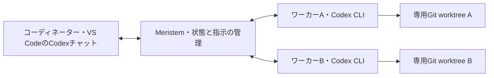

# Meristem

**日本語** | [English](README.en.md)

**VS CodeのCodexチャットから、複数の独立したCodex CLIチャットへ作業を割り当て、報告・停止・Git統合を管理するWindows向けの実験的ツールです。**

このREADMEでは、調整役を**親チャット（コーディネーター）**、実装担当を**子チャット（ワーカー）**と呼び、以降は「コーディネーター」「ワーカー」で表記します。ワーカーは独立した会話履歴を持つCodex CLIチャットで、コーディネーターやワーカーが内部で使うサブエージェントとは区別します。

普段使うCodex拡張をコーディネーターとして使い、各ワーカーの状態をVS Code下部のターミナルで確認できます。工程表に沿う直列作業と、最大2つのワーカーによる並列作業に対応しています。

> 現在は開発者向けの実験段階です。専用のVS Codeプロファイルで実機検証しており、通常プロファイルでの常用や幅広い環境での安定動作を保証するものではありません。

## できること

| 機能 | 内容 |
|---|---|
| 工程ごとのワーカー割当 | Markdownの工程表から依存関係と作業範囲を確認し、Git worktreeとブランチを分けて作業します。 |
| 直列・並列の実行 | 依存する工程は順番に、作業範囲や共有資源が競合しない工程は最大2つのワーカーで進めます。 |
| 修正と引継ぎ | 同じ会話履歴での修正と、新しいワーカーへの引継ぎをコーディネーターが選べます。 |
| 報告後のコーディネーターの再開 | 設定を有効にすると、保存した報告と終了状態を確認してコーディネーターを再開します。通常監視はモデルを呼びません。 |
| 質問と人の承認 | ワーカーの質問をコーディネーターが扱い、対応する承認要求は人が正式な画面で判断します。 |
| Git成果の受入 | ワーカーの候補SHAと統合後のSHAを区別し、検証結果とGitの実状態を確認して次の工程へ進みます。 |
| 停止と記録の保持 | 所有プロセスの停止を確認し、作業ファイル・ブランチ・報告を保持します。結果不明の指示は自動再送しません。 |

## 動き方



1. 人が対象のコーディネーター・工程表・リポジトリ・ブランチを確認し、実行を許可します。
2. コーディネーターがワーカーへ作業を割り当て、ワーカーは専用worktreeで実装・検証し、成果と報告を残します。
3. コーディネーターが報告、正常なターン終了、未解決の要求、プロセスの終了、Git成果を確認します。
4. コーディネーターが候補を受け入れて統合し、統合後の検証を通してから依存する次の工程を解放します。

ワーカーターミナルは状態と限定ログを表示する**読取専用**です。直接入力や貼付けでワーカーへ指示するものではありません。コーディネーター／ワーカーの具体的な手順は[運用スキル](skills/codex-chat-coordination/SKILL.md)と[工程表・報告形式](skills/codex-chat-coordination/references/plan-and-report.md)を参照してください。

## 現在の検証状況

2026年11月16日の[総合受入記録](docs/validation/chat-control/CC-07.md)と[継続受入記録](docs/validation/chat-control/CC-07-continuation.md)では、専用環境で次を確認しています。

- 実CodexとVS Codeによる直列作業、同履歴での報告修正、新しいワーカーへの引継ぎ、質問応答。
- 2つのワーカーの並列作業、固定した候補の統合、統合後に検出した不整合の修正。
- ワーカータブの閉鎖、コーディネーターの停止、VS Codeの再読込みに対する停止・照合・成果保持。
- 専用環境への導入と設定復元、非公開GitHub試験ブランチへの統合結果のpushと再取得確認。
- 自動検証234件（native/spike 39、control 181、terminal 14）、型検査、ビルドの成功。

これは記録した環境・シナリオでの結果です。各試験の失敗・未確認事項も保持しており、通常プロファイルへの導入や他環境での動作確認とは区別しています。

## 必要な環境

| 項目 | 条件 |
|---|---|
| OS | Windows x64 |
| Node.js | ソース版は24.22.1以上。Windows x64配布ZIPには同梱しています。 |
| VS Code | 1.90以上。実機実行には公式Codex拡張と専用プロファイルも必要です。 |
| Git | コマンドラインで利用できること。worktreeとブランチを使用します。 |
| ネイティブビルド | ソース版はWindowsの.NET Framework x64コンパイラ（`csc.exe`）が必要です。配布ZIPはコンパイル不要です。PowerShellのスクリプト実行は許可されている必要があります。 |
| 実モデルの認証 | 正式なChatGPTログイン済みの専用Codex home |

実機検証で使用したCodexは `0.169.0-alpha.11.1`、Node.jsは `24.22.1` です。Codex/Nodeの実行ファイル・入口の絶対パスとSHA-256を固定します。別のCodex版への互換性は未保証で、更新時にhashだけを書き換えて有効化する運用は想定していません。

## 試すには

ビルド済みの [v0.1.0 Release](https://github.com/takikomirice/meristem/releases/tag/v0.1.0) を用意しています。Windows x64用ZIPには本体・補助拡張・Node.js・依存ライブラリを含み、コンパイルやNode.jsの別途導入は不要です。[配布版の導入案内](docs/releases/INSTALL.ja.md)を参照してください。専用環境の設定・正式ログイン・人による実行許可は引き続き必要です。

以下はソースから開発・検証する場合の手順です。

### 1. モデルを呼ばずにビルド・検証する

リポジトリのルートで実行します。

```powershell
npm ci --ignore-scripts
npm run verify
```

`verify` はネイティブ実行ファイル、TypeScript、補助拡張をビルドし、偽Codex／偽MCPクライアントとローカルGitを使うテストを実行します。実モデルやGitHubには接続しません。この段階ではVS Codeへの導入やワーカーの実モデル起動は行いません。

### 2. 専用環境で実Codexを接続する

実機接続には、専用プロファイル、正式認証、検証するCodexの固定、対象工程表とGit範囲、設定ファイルの準備が必要です。現時点ではワンコマンドで通常環境へ導入する構成ではありません。

[導入・運用・検証リファレンス](docs/chat-control-reference.ja.md)に、VSIXの作成、導入設定の例、実行許可、起動、停止、アンインストール、実機試験runnerの手順をまとめています。実モデル試験は送信回数の上限を事前に決め、人の承認を伴う専用環境で行ってください。通常プロファイルへの導入は別途明示的に判断する操作です。

## 停止と復旧

| 操作 | 挙動 |
|---|---|
| ワーカーを停止 | コーディネーターの `stop_worker`、実行中のワーカータブの閉鎖、または `Meristem: Stop Current Worker`。新しい指示とコーディネーターの自動再開を禁止し、対象のワーカーを停止します。別のワーカーは現在のターンを終えて報告できる場合があります。 |
| 全体を停止 | コーディネーターの `stop_run`、コーディネーターの通常UIの停止、またはローカルCLIの `stop`。管理しているワーカーをすべて停止します。 |
| 状態を確認 | コーディネーターの `get_status` またはローカルCLIの `status`。接続が切れている場合は、停止成功と見なさず `needs_reconcile` として照合を要求します。 |
| 設定を戻す | 全体停止と専用ウィンドウ終了を確認してからuninstall。利用者が後で変更した設定値は保持します。 |

パネルを隠す・タブを切り替えるだけでは停止しません。完了済みタブの閉鎖は表示だけを閉じます。VS Codeやbrokerの再起動後にワーカーを自動復元せず、状態照合と人の再確認後に明示再開します。作業ファイル・ブランチ・状態DB・検証記録は停止やuninstallで削除しません。

## 制約

- Windows向けです。macOS／Linuxでの動作は検証していません。
- ワーカーへの直接入力、対話型TUI、全文会話ログのターミナル表示はありません。
- ワーカーの承認経路は一部のローカルMCP要求と固定Gitパスに限定しています。任意のコマンド・ネットワーク・認証などの要求には対応していません。
- VS Code終了後の継続実行・自動復元には対応していません。
- 過去の起動・切断失敗には原因未特定のものがあります。すべての失敗が解決済みという意味ではありません。
- 通常プロファイルでの常用、Marketplace公開、自動起動登録は検証・提供の範囲外です。

## ドキュメントとコード

| 目的 | 参照先 |
|---|---|
| 導入・起動・停止・復元の詳細 | [導入・運用・検証リファレンス](docs/chat-control-reference.ja.md) |
| コーディネーターとワーカーの操作手順 | [運用スキル](skills/codex-chat-coordination/SKILL.md)（英語） |
| 工程表と構造化報告の契約 | [形式リファレンス](skills/codex-chat-coordination/references/plan-and-report.md)（英語） |
| 最新の総合受入と制約 | [CC-07](docs/validation/chat-control/CC-07.md)・[継続受入](docs/validation/chat-control/CC-07-continuation.md) |
| 設計と工程別の実装計画 | [設計](docs/superpowers/specs/2026-11-15-codex-chat-control-design.md)・[実装計画](docs/superpowers/plans/2026-11-15-codex-chat-control-implementation.md) |
| 仲介・状態管理・MCP・Git検証 | [`src/`](src/) |
| Windowsのプロセス管理・中継 | [`native/`](native/) |
| VS Codeのワーカーターミナル・承認画面 | [`extension/`](extension/) |
| 自動検証と実機試験runner | [`test/`](test/) |

詳細な導入・検証資料は主に日本語です。英語の概要は [README.en.md](README.en.md) を参照してください。

## ライセンス

本プロジェクト独自のコードとドキュメントは [MIT License](LICENSE) で提供します。著作権表示とライセンス本文を保持してください。依存パッケージのライセンスは [Third-party notices](THIRD_PARTY_NOTICES.md) を参照してください。

ログの除外、検証記録の伏せ字処理、確認範囲とGit履歴の扱いは[公開準備の記録](docs/publication-preparation.md)、配布内容と制約は [v0.1.0 Releaseノート](docs/releases/v0.1.0.md)にまとめています。
