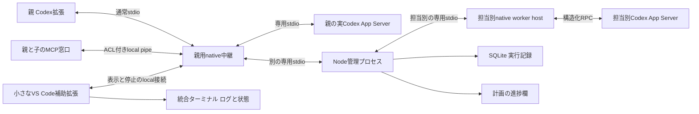

# Codex拡張を親、CLIを子とする連続実装の設計

改訂日: 2026-11-15（日本時間）、revision 2。[実装計画](../plans/2026-11-15-codex-chat-control-implementation.md)と合わせて、今回変更するのは文書だけ。新方式の実装・依存導入・設定変更・実モデル試験は行わない。

## 1. 目的と今回の合意

普段のVS CodeのCodex拡張を親として、Markdownの工程表から子CLIへ実装・検証・Git作業を割り当てる。子のログ・状態・停止操作を同じVS Codeの統合ターミナルにまとめる。工程の意味、修正方針、次の担当、Git競合の解消は親AIが判断し、プログラムは接続・記録・実行条件・配送・停止を管理する。

ユーザーとの会話で、子を通常のCodexパネルに表示する要件を外し、子CLIの直接入力は後回しとした。初期版のターミナルは、対話型Codex CLIのTUIではなく、`codex app-server`で動く担当のログ・状態を表示する。親からの自動指示は構造化RPCで送り、terminalの文字列へ指示を打ち込まない。

子の実行プロセスは工程・試行ごとに作って終了できる。成果コミット、報告、実行記録、必要なthread IDは終了後も残す。新しい工程は新しい子を既定とし、親が必要と判断した修正だけ同じ担当の履歴を継続できる。継続のためにプロセスやターミナルを常時残すことは要求しない。

## 2. 検証済みの事実と新しい前提

[旧CC-00](../../validation/chat-control/CC-00.md)では、同じ拡張所有接続での子表示・追加依頼、終了済み親の新ターン、実MCP metadataの相関を確認した。一方、UI停止でturnが`interrupted`になっても、開始済みのshellコマンドの追記は続いた。旧方式の採用判定は保留のまま保持する。

この改訂は、旧A経路の失敗を合格へ変更するものではない。親は旧Aの通常拡張、子は専用プロセスで所有するCLIへ明示的に変更する。新しい子の停止、ターミナル連携、brokerを経由した親再開は未実証であり、**CC-00Rの合格後だけCC-01へ進める**。

| 項目 | 方針 | 根拠 |
|---|---|---|
| 親 | 普段のCodex拡張の通常チャット | 継続するユーザー要件 |
| 子 | 担当ごとの独立CLI App Serverとroot thread | 今回の合意 |
| 見る場所 | 同じVS Codeの統合ターミナル。担当名・工程・状態・ログを表示 | 今回の合意 |
| 子への人の直接指示 | 初期版では受け付けない。入力文字をRPCへ転送しない | 今回の合意 |
| 子への自動指示 | 親MCP→broker→対象workerの専用stdio | 設計上の選択 |
| 子の寿命 | 一つのroot担当を一つの専用実行単位で所有。初期同時実行は2件 | 停止の分離と小規模受入のための選択 |
| 待機 | 親は応答を終えてよい。監視中のモデル定期呼出しなし | 継続要件 |
| 子の直接入力・TUI・外部terminal window | 後回し | 初期版の範囲 |
| VS Code終了後 | 実行継続・自動起動は保証しない。記録から明示的に照合・再開 | 初期版の範囲 |

## 3. 構成と責任

### 親用中継とNode管理プロセス

親用中継は残す。親の通常通信を透過転送し、親の状態・実MCP呼出し元を観測して、安全に新ターンを開始する入口とする。子のroot threadは親App Server内に作成しない。親の中継と子の実行管理は責任を分ける。

Node.js 24の管理プロセスを親用中継の子として一つ起動する。既存のNode環境を使い、VS Code内蔵NodeのSQLite対応を仮定しない。親App Serverとbrokerは別の所有単位とし、brokerの障害で親の通常UIを終了しない。brokerは子hostを所有し、停止・切断時は新規配送と親再開を止める。

追加接続の入口はnativeのACL付きnamed pipeへ集約する。親・子MCP、補助拡張、ローカル停止CLIは、それぞれ許可した役割だけを利用する。Node側に二つ目のHTTP／pipeサーバーやWindowsサービスを追加しない。初期版は一つの制御ウィンドウに限定し、別ウィンドウを自動的に取り込まない。起動ごとのowner/epochと明示bindingで選び、最新のPIDや最終活動で推測しない。

pipeは同時接続を上限16件に制限して扱い、単一DB writerと単一クライアント接続を混同しない。表示用接続がMCPや停止要求を占有しないよう、terminalのイベント読取りは500 ms間隔・最大100件の有限pollとする。無期限の購読要求を制御口へ保持しない。

`chatgpt.cliExecutable`は開発専用設定であり、専用profileから開始する。親拡張の本体・initializeのcapabilities・権限設定を書き換えない。本物のexeは絶対パス・SHA-256・版を確認し、PATHやglobから自動選択しない。旧中継のID-first形式依存と完全ID衝突分岐は、親用に残る制約としてCC-00Rで評価する。未解決の管理応答漏出を後工程へ持ち込まない。

### 担当別worker host

一つのworker hostに一つの子Codex App Serverと一つの管理対象root threadを持たせる。workerごとのcwdは専用worktreeへ固定する。内部スキル・サブエージェントは互換性試験の対象だが、内部threadを別の担当として自動登録しない。

WindowsのJob Objectを使い、子をsuspendedで作成して所属・所有を確認後に実行する。既存の`ProcessTree.cs`を参考・再利用し、親用の共有jobへ全workerを混在させない。別担当・親・対照プロセスを子の停止範囲へ入れない。host自身が終了した場合と、brokerとの入力接続がEOFになった場合も、所有jobを閉じて終了を確認する。起動競合で無管理の子を残さない。

公式sandboxや外部の実行サービスが開始した処理は、jobに含まれると推測しない。実Codexで開始したshell・孫プロセスの停止をマーカーと所有identityで確認する。停止範囲を証明できない場合は`unknown`として後工程を止める。権限制約を緩めてjobへ入ったように扱わない。

### VS Code補助拡張とターミナル

公式APIの`window.createTerminal({ name, pty, isTransient: true })`と`Pseudoterminal`を使う小さな補助拡張を作る。担当作成・実行の判断やDB書込みはbrokerに置き、補助拡張は表示・人の停止・承認専用UIだけを扱う。VS Code APIの対応版は実装時に型定義と実環境を照合する。

ターミナル名は`工程ID / 担当ID`。先頭と状態変更時にcwd、branch、指定model/effort、実行中・回答待ち・停止要求中・停止済み・停止確認不能・完了を表示する。「停止済み」はプロセス終了確認後だけ使う。raw JSON-RPC、秘密、認証応答は表示せず、allowlistの進行ログをANSI/OSC等の制御シーケンスを除いて表示する。ログ量を制限し、表示が詰まってもApp Serverの読取りを止めない。

表示イベントは最大64 KiB、terminalごとの未描画キューは最大1 MiBとする。超過分は本文を切り詰め／省略し、その件数を表示する。状態と停止結果は最新値の再取得で補い、ログ省略を成功・停止の根拠にしない。

`handleInput`や`Terminal.sendText`を子へつながない。貼付け・入力文字から新ターンやshell実行を始めない。タブの閉鎖と明示的な「この担当を停止」コマンドを同じbroker操作へ接続する。パネルを隠す操作やタブ切替では止めない。自然終了後のログタブは確認用に残し、そのタブを閉じてもrunや兄弟を停止しない。`isTransient`で表示タブを自動復元の対象外にするが、実行記録は保持する。

## 4. ライフサイクルと停止

`assignmentId`は工程への割当、`attemptId`は一回の実行、`workerId`は担当、`threadId`は履歴。PIDやterminal名をこれらの代用にしない。worker hostを作り直したらownerEpoch・attemptId・terminal bindingも新しくする。同じ履歴の再利用は親の明示判断で行い、完了・中断・不明な操作の照合を省かない。

| 操作 | 動作 |
|---|---|
| 親から子へ指示 | 対象worker、owner/epoch、thread、revision、cwd、実catalogを検証し、記録後に送る |
| 人が実行中の子タブを閉じる／子停止 | runの新規配送・親再開を先に止める。対象子だけを停止し、兄弟は現在ターンの完了と報告保存まで可能 |
| 親の通常UI停止／全体停止 | run停止を先に保存し、全管理対象workerを個別に停止。対象外の親チャットや別runは停止しない |
| 完了後に子タブを閉じる | 保存済み報告とGitを保持し、表示だけを片付ける |
| worker正常完了 | 報告・正常turn完了・候補の事実を保存。所有プロセスの後始末を確認し、ログを残す |
| broker／補助拡張の切断、VS Code終了 | 新規配送・wakeを禁止。所有workerを終了させ、再起動時は`needs_reconcile`。自動再送・自動再実行はしない |

停止手順は、停止理由・世代を確定→未送信操作とwakeを取消→対応turnに`turn/interrupt`→猶予後も残ればそのworker専用jobを終了→プロセス群の不在と追加マーカーなしを確認、の順とする。初期値はinterrupt猶予3秒、強制終了後の確認上限5秒、500 ms間隔マーカーの無増加観測2秒。これらは実装上の選択で、実機で成立しなければ値を長くして隠さず理由を調べる。

`StopResult`は各attemptの`interrupt_requested / stopping / stopped / unknown`と根拠を持つ。terminal閉鎖、RPC受付、turn中断、プロセス終了、ファイル追記停止を別の観測として保存する。結果不明のworkerがあれば、run停止を維持して次工程や同じworktreeの再利用を禁止する。

## 5. MCP・身元・記録

親の身元は、実MCP metadataのthread/turnと親所有接続を照合する。旧CC-00で確認した`x-codex-turn-metadata.thread_id`／`turn_id`等は版付きの候補であり、欠落・相関不能時は変更系操作を拒否する。

子MCPは専用workerの起動記録・接続元とmetadataを照合する。単に子の引数に`role=parent`や`callerThreadId`を与える方式は禁止。native側で接続元PIDと作成identity、該当jobへの所属を確認し、brokerが記録したroot threadに結び付ける。内部サブエージェント、別worker、過去epochは親や主担当へ自己昇格できない。この照合が実環境でできなければ変更系操作を利用不可にする。

初回は、人が親thread・計画hash・repo・作業ブランチ範囲を正式なelicitationまたはローカル確認でbindingする。一回限りの`RunPermit`を保存し、別親・別repo・別runへ流用しない。補助拡張は明示bindingしたownerの表示・停止だけに接続し、ウィンドウ名や同名terminalから管理権限を推定しない。

SQLiteはNode管理プロセス一つが書く。DB・制御credential・discovery情報はユーザーの管理領域に置き、worktreeへ置かない。ACLに加え、子の実permission profileから読めないことを実機で試す。非sandboxの同一OS利用者の全プロセスに対する防御は保証しない。

操作IDとpayload hash、revisionをtransactionで確定してから外部I/Oへ進む。配送状態は`prepared / sent_unknown / acked / settled / cancelled`。応答喪失時は履歴・プロセス・Gitを照合し、盲目的に再送しない。raw通信・認証payloadは保存せず、必要なID・状態・承認要求の最小情報だけをallowlistで保存する。

## 6. 親の休止と再開

親は依頼後に最終応答してよい。子完了・失敗・親への質問・人の承認待ちだけを通知候補にし、通常ログ・delta・heartbeatで親モデルを呼ばない。報告保存と親が読んだ事実を区別する。

主経路は親用中継から同じ所有接続への`turn/start`。親がidleかつrunがactiveの時だけ使い、activeなら蓄積する。MCP通知やterminalへの表示だけで親を起動したことにしない。標準queueを使う別案と二重配送しない。

親用の単一送信箇所で人の入力・queue操作・pending startを観測し、ownerEpochと最後の状態seqを検証して枠を予約する。外部workerになっても親の入力競合は残る。保証できないwriter／内部起動条件では自動再開を禁止する。初期受入は親再開12回、各工程の修正2回までとし、上限で記録して止める。

## 7. 質問と人の承認

直接CLI入力を後回しにしても、質問・正式な承認・拒否・取消は省かない。普通の質問は親が仕様から回答できる。構造化質問は元requestへ返し、自然文で終了した質問は同じ履歴への次ターンとして扱う。

子に通常のCodexパネルはないため、「子の公式パネルへ戻せば解決」という旧前提は使わない。command/file/permissionsの承認は、元request ID・owner/epoch・turn・payload hash・必要範囲を示した親側の正式elicitation、または補助拡張の承認専用modalから人の回答を取得する。modalを使えるのは元APIがそのクライアントの人の応答を許す要求だけ。モデルのbooleanや通常のテキスト返信で人の許可を代用しない。

connector／appの承認、公式reviewerの要求、OS承認、ログインは個別の正式経路に従う。対応するUIがなければ`waiting_approval`／`unsupported`として止め、CLIを対話モードへ切り替えたり認証を代理実行したりしない。ChatGPTの既存の正式ログイン経路を使い、APIキー課金へ暗黙に切り替えない。

期限切れ・解決済み・中断済み要求への遅い回答は拒否する。親のMCP timeoutやmodal取消だけでは、子の元要求を承認済み／拒否済みにしない。再提示は同じrequest keyと新しいフォーム世代で行う。

## 8. 工程表・Git・使い捨ての境界

Markdownを計画の正本、SQLiteを実行記録の正本とする。自由記述を残し、機械管理領域だけをhash付きで更新する。対象ファイルが別でも、lockfile・migration等の競合資源が重なれば並列化しない。

子ごとのworktree／branchと親専用のintegration worktreeを分ける。報告のbase/candidate SHA、repo、branch、clean状態、push先到達をGitから別途確認する。報告＋正常なturn完了＋未解決要求なし＋後始末完了が揃うまで候補を確定しない。

`accept_candidate`は候補固定だけ。検証済み`integrationSha`を保存する`accept_integration`だけが依存を解放する。次工程の`baseSha`には全先行integration SHAを含める。同じ履歴の再利用でも、前attemptの終了・worktreeのclean・Git追従を確認する。dirtyな作業場所、未コミット変更の破棄、main/protected branchへの直接push、force-pushを既定にしない。

「使い捨て」はプロセスの寿命を指す。未コミット変更・worktree・branch・報告・証拠を自動削除する意味ではない。閉じたターミナルや終了PIDから成果の成功を推測しない。

## 9. 技術・ゲート・対象外

現リポジトリのNode基準は24.22.1、MCP SDKは1.32.2、zodは4.6.7。TypeScript・VS Code型定義・yamlは必要な工程で互換性を確認してlockし、今回導入済みとは扱わない。.NET Framework標準APIとVS Code標準APIを優先し、ConPTYライブラリ・Webview・HTTPサーバー・クラウドDB・Windowsサービスを初期版に追加しない。

ゲートは、CC-00Rで専用workerの実停止と統合ターミナル、CC-01で永続化と権限制約、CC-02で実MCP、CC-03で無人の2工程、CC-04で人の質問／承認、CC-05/06で直列／並列Git、CC-07で通常導入とする。CC-00R不成立ならCC-01へ進めない。承認未対応の場合も、対応済みの範囲だけを明示する。

直接CLI入力、TUI、子の通常Codexパネル、外部terminal window、VS Code終了後の継続運転、公開配布は初期版の対象外。子のモデル・effortの実効値、sandboxを経た停止、ターミナルとbrokerの終了競合は、新構成の実機証拠が得られるまで未確認。

## 10. 参照

- [実装計画](../plans/2026-11-15-codex-chat-control-implementation.md)、[旧CC-00結果](../../validation/chat-control/CC-00.md)、[旧調査結果](../../validation/chat-control/report.md)、[固定版の生成型・hash](../../validation/chat-control/evidence/inventory.json)
- [VS Code API: Terminal / Pseudoterminal](https://code.visualstudio.com/api/references/vscode-api)、[Job Objects](https://learn.microsoft.com/en-us/windows/win32/procthread/job-objects)、[named pipeのアクセス制御](https://learn.microsoft.com/en-us/windows/win32/ipc/named-pipe-security-and-access-rights)
- [Codex App Server](https://learn.chatgpt.com/docs/app-server)、[MCP elicitation](https://modelcontextprotocol.io/specification/2025-06-18/client/elicitation)

APIの存在と、この構成での実機成立は別である。今回の改訂を実装・導入・受入成功として扱わない。
