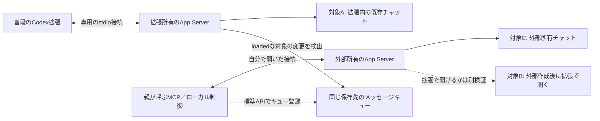

# Codex独立チャット間制御の調査結果

> 公開用の写しです。個人のパスや非公開試験リポジトリの識別子を置き換えています。試験結果・版・ハッシュは変更していません。[処理の範囲](../../publication-preparation.md)を参照してください。

調査日: 2026-11-14（日本時間）  
対象: [調査計画](../../superpowers/plans/2026-11-14-codex-chat-control-investigation.md)

## 1. 結論

**必要な部品の多くは既に標準機能として存在する。追加実装も可能。ただし、普段のVS Code拡張内の独立チャットを、親から完全に管理する仕組みが、そのまま一式で提供されていることは確認できなかった。**

特に、計画書の事前情報にはなかった **`codex queue`** が重要である。既存チャットへUUIDを指定してメッセージを登録できる。公式実装には、別プロセスから保存されたキューをチャット所有側が検出し、idle時にターンを起動する経路もある。「既存拡張チャットへの送信には必ず非公式な中継が必要」「親が最終回答すると絶対に再開できない」とは判断しない。[公式コマンド資料](https://learn.chatgpt.com/docs/developer-commands#codex-queue)、[公式キュー実装](https://github.com/openai/codex/blob/d32063f96c2dff1dc96af839b3952abb6acfeda4/codex-rs/ext/queue/src/service.rs#L90)

一方、キューは送信時のモデル指定、厳密な実行状態の取得、実行中ターンの中断をまとめて解決するものではない。**第一希望を全て満たす候補は、標準機能の組合せを先に試し、足りない接続だけをWindows向け通信中継で補う構成**になる。通信中継なしで十分かどうかは、要求する観測・停止・設定変更の厳密さによる。

| 要求 | 標準機能 | 実装可否と条件 |
|---|---|---|
| Q1 他チャットの状態観測 | App Serverに状態・ターン結果・承認／入力待ちのAPIがある | **可能**。自分が接続するサーバーの状態は取得できる。既存拡張所有のチャットを完全に観測するには、その所有側のイベント取得経路が必要 |
| Q2 独立チャットの新規作成 | `thread/start`、拡張の新規チャット／パネルコマンドがある | **可能**。APIでの作成と、拡張で一覧・画面に表示できることは別。外部作成チャットの表示同期は未検証 |
| Q3 別チャットへの指示・修正・中断 | 送信は`codex queue`。所有側APIには`turn/start`、`turn/steer`、`turn/interrupt`がある | **可能**。既存拡張へはキューが第一候補。キューだけでは即時中断や厳密な宛先ターンの追跡まで満たさない |
| Q4 宛先のモデル・推論強度指定 | 所有側APIに`model`／`effort`、モデル一覧がある | **可能**。`codex queue`単体では不可。所有側APIへの接続、または外部所有チャットでの実行が必要 |
| R5 報告後の親の自動続行 | MCPツール結果、標準キュー、Stop hookという部品がある | **条件付きで可能**。親が待機中か、終了後もloadedか、unloaded／拡張終了かで経路が違う |
| R6 承認通知・全体停止・復旧 | 所有側APIに承認要求・応答・再開等がある | **追加実装が必要**。操作記録、重複防止、停止状態、承認主体の分離は制御側の責務 |

API欄は公式資料と**実際の同梱実行ファイルから生成した型定義**で確認した存在を表す。全機能の実機合格を意味しない。今回の範囲は技術調査、隔離したメタデータ試験、候補比較であり、R1〜R7全体の実機受入完了ではない。

## 2. 対象環境と確認の範囲

| 項目 | 今回確認した値・範囲 |
|---|---|
| 作業場所 | `C:\work\meristem`。Git管理外。開始時点では調査計画書のみ |
| OS | 隔離App Serverが`Windows 10.0.26300; x86_64`と報告 |
| Node.js | `v24.22.1` |
| VS Code | CLI出力`1.146.0`。画面操作による確認は未実施 |
| Codex拡張 | `openai.chatgpt-26.1111.21308-win32-x64`、manifest版`26.1111.21308` |
| 拡張同梱Codex | **`0.169.0-alpha.11.1`**。このexeを明示してhelp・型生成・隔離試験を実行 |
| PATH上のCodex | `0.164.0`。拡張同梱版と異なるため主な判定には使用しない |
| 拡張の既定起動経路 | インストール済みbundleでは子プロセスのstdio接続。`chatgpt.cliExecutable`で実行ファイルを変更する分岐あり |
| 普段の拡張が実際に起動中のexe | **未確認**。`Win32_Process`の列挙はこの実行環境で拒否された。既定経路の静的確認と区別する |
| 認証・利用可能モデル | 試験用`CODEX_HOME`は未認証。普段のアカウントの現在のモデル利用権は確認していない |
| 実モデル呼出し | **0回**。APIキーの利用、ログイン、既存チャットへの送信・中断は行っていない |
| 導入・設定変更 | 拡張、MCP、プラグイン、ユーザー設定への変更なし |

型定義は通常生成784ファイル、`--experimental`付き951ファイル。exe・manifest・bundle・生成物のSHA-256、接続に関係するbundle内の文字位置は[inventory.json](evidence/inventory.json)に保存した。通常生成は「製品の全APIが安定保証される」という意味ではなく、実験的メソッド／フィールドを除外した生成結果を指す。

公式コードの比較対象はrelease `0.169.0`、commit `d32063f96c2dff1dc96af839b3952abb6acfeda4`。同梱alpha版とソースが完全一致することまでは証明していない。同梱版の有無・形状には生成型とhelpを優先し、公式ソースは動作方式の根拠として扱う。

## 3. 所有関係と接続先



同じthread IDの履歴を読めることと、そのIDを実行しているプロセスへ接続できることは違う。別App Serverの`thread/read`で`notLoaded`になっても、拡張側で実行していない証拠にはならない。別プロセスでの`resume`を「受動的な監視」として使わない。

ただし、**標準キューはこの所有関係をまたぐ送信候補**になる。公式の`thread/queue/add`処理は、受信サーバーにロードされていない通常チャットでも保存済みメタデータを確認して登録する。所有側のキュー拡張には、loadedなthreadに関係する外部変更を検出する処理がある。DBを自作コードで直接編集する案ではなく、標準コマンド／APIを使う案である。[登録処理](https://github.com/openai/codex/blob/d32063f96c2dff1dc96af839b3952abb6acfeda4/codex-rs/app-server/src/request_processors/thread_queue_processor.rs#L255)、[外部変更の検出](https://github.com/openai/codex/blob/d32063f96c2dff1dc96af839b3952abb6acfeda4/codex-rs/ext/queue/src/service.rs#L90)

同じWindowsユーザーでも、`CODEX_HOME`、保存先、拡張の設定、実行版が異なれば、この連携が成立するとは限らない。既存拡張Aでの成功判定には実画面での試験が必要。

## 4. 要求別の調査結果

### Q1: 状態観測

同梱版の通常生成型に、以下を確認した。

| 情報 | API・型 | 注意点 |
|---|---|---|
| 会話一覧・現在ロード中の会話 | `thread/list`、`thread/loaded/list`、`thread/read` | 接続先サーバーのruntimeと永続履歴を区別する |
| 会話の状態 | `ThreadStatus`: `notLoaded` / `idle` / `systemError` / `active` | `idle`は工程の成功ではない |
| 待ち状態 | `ThreadActiveFlag`: `waitingOnApproval` / `waitingOnUserInput` | 認証要求や未知の要求は別に分類する |
| ターン結果 | `TurnStatus`: `inProgress` / `completed` / `failed` / `interrupted` | 依頼の完了条件やコマンド成功とは別 |
| 状態変化 | `thread/status/changed`、`turn/started`、`turn/completed` | 所有側のイベントを継続購読する必要がある |
| 承認・入力の詳細 | `item/*/requestApproval`、`item/tool/requestUserInput`、`mcpServer/elicitation/request` | request IDとthread／turnを関連付ける |

**CはAPIクライアントで実装可能。Aは標準キューだけで完全な状態観測はできない。** 補助候補は、子の明示的な`report`ツール、公式hookによる通知、履歴の読取り。通信断や通知欠落を含む完全な観測には、所有側のイベント中継が必要になる。

`PreModelRequest`／`PostModelRequest` hookはモデル名とturn ID等を観測する候補だが、公式資料では診断用であり、コンテキスト変更や要求のブロックには使えない。[Hooks仕様](https://learn.chatgpt.com/docs/hooks#premodelrequest-and-postmodelrequest)

### Q2: 新しい独立チャット

`thread/start`に作業場所`cwd`を指定してルートチャットを作成できる。今回、隔離した未認証App Serverで2回実行し、**異なるID、`parentThreadId=null`、指定cwd、空履歴、idle**を確認した。サブエージェントの作成を独立チャットの成功に置き換えていない。[試験結果](evidence/metadata-smoke.json)

ただし試験は`ephemeral:true`であり、永続履歴の再開、内容の独立性、拡張の一覧表示を試していない。標準キューはephemeralチャットには対応しないため、このメタデータ試験をキュー連携の証拠にも使わない。

拡張には`chatgpt.newChat`と`chatgpt.newCodexPanel`がある。調査した登録処理は画面側の新規作成を起動するもので、外部制御用の「指定cwd・モデルで作成しthread IDを返す」公開APIではない。公開コマンドだけでは一式を満たせない。[IDEコマンド資料](https://learn.chatgpt.com/docs/developer-commands#ide-extension-commands)

Bは、外部作成threadを拡張で開く／履歴を再表示する候補があるが、一覧フィルター、表示更新、同時接続、書込み所有権の引継ぎを未検証。単に同じ保存場所へ作成しただけで通常UI連携に合格とはしない。

### Q3: 指示・同じ相手への修正・中断

**既存チャットへ送る標準コマンドがある。** 次は将来の試験用の形であり、今回実チャットには実行していない。

```powershell
& $codexExe queue --thread $targetThreadId --message $instruction
```

`--thread`はUUIDまたは完全一致の名前。自動運転ではUUIDを固定する。`--last`、最新更新、前面パネルによる推測は使わない。キューは既存の会話設定で処理され、テキストのみを受け付ける。[標準仕様](https://learn.chatgpt.com/docs/developer-commands#codex-queue)

今回確認した公式ソースでは、外部変更の検出間隔は10秒。これは実装上の値で、実行開始まで10秒以内という保証ではない。activeな会話、承認待ち、中断済み、unloaded等には別の待機・再開条件がある。[キュー所有側処理](https://github.com/openai/codex/blob/d32063f96c2dff1dc96af839b3952abb6acfeda4/codex-rs/ext/queue/src/service.rs#L90)

`--resume`も同梱版に存在する。ただしローカルdaemon／指定したremote server側で再開を試す機能であり、**任意の拡張所有プロセスに強制接続するものではない**。再開失敗時は警告を出しながらキュー登録自体は成功扱いになる。終了コード0だけを「相手が実行した」と解釈しない。[公式変更とテスト説明](https://github.com/openai/codex/pull/57232)、[同梱版help](evidence/queue-help.txt)

所有側の接続を持つ場合は、通常の次ターンに`turn/start`、実行中への追加入力に`turn/steer`、中断に`turn/interrupt`を使える。`turn/steer`には`expectedTurnId`の前提条件がある。追加入力と、現在のターンを止めて別ターンを開始する操作を分ける。

**中断はキューからの取消とは別。** 公式テストには「中断後もキューを保持する」ケースがある。全体停止では、制御側の停止状態を保存し、管理対象の未処理送信を取り消し、実行中ターンと管理対象コマンドの終了を確認する必要がある。キュー取消と実行開始には競合があるため、停止後の再読取りも必要。[キュー回帰テスト](https://github.com/openai/codex/blob/d32063f96c2dff1dc96af839b3952abb6acfeda4/codex-rs/app-server/tests/suite/v2/thread_queue.rs#L587)

実験的APIには`thread/backgroundTerminals/list`／`terminate`／`clean`もあるが、`turn/interrupt`受付やこれらの存在から、子孫プロセス全停止を実証したことにはしない。拡張所有App Server全体をkillすると無関係なチャットも巻き込むため、Aの停止手段には採用しない。

### Q4: 宛先モデル・推論強度

| 場面 | 同梱版で確認した指定口 | 判定 |
|---|---|---|
| 組合せの取得 | `model/list`、`supportedReasoningEfforts` | APIあり。実アカウントで現在使える組合せは未取得 |
| 新規会話 | `thread/start.model`、config経由の既定設定 | 指定口あり。初回の`turn/start`で`model`と`effort`を明示する方が追跡しやすい |
| 次ターン | `turn/start.model`／`effort` | 通常生成型に存在。コメント上、そのターンと後続ターンの設定を変更する |
| 後続ターンの設定更新 | `thread/settings/update` | 実験的。実行中ターンを変更する操作と分離されている |
| 実行中ターンの設定更新 | `turn/settings/update` | **実験的APIが存在する**。単純に「実行中変更は不可能」とは判断しない |
| 標準キューへの送信時 | `codex queue` | `--model`と`model`設定上書きを拒否する。キュー単体ではQ4を満たさない |

`turn/settings/update`は、その実行中ターンの後続処理に設定を公開する仕組みで、既に開始済みの処理や初期設定を固定した利用箇所、子セッションまで変更する保証はない。返却値も`applied`／`targetUnavailable`であり、実モデルの途中切替を今回試したわけではない。[実行中設定の公式テスト](https://github.com/openai/codex/blob/d32063f96c2dff1dc96af839b3952abb6acfeda4/codex-rs/app-server/tests/suite/v2/turn_settings_update.rs)、[ローカル生成契約](evidence/inventory.json)

実効値についても制約がある。`Thread.model`／`reasoningEffort`の型コメントは、**現在の設定または最後の永続設定であり、ターンごとの実行テレメトリではない**と明記している。`turn/start`応答は`turn`のみで、実効モデル・effortの完全な証明を返す形ではない。

実装時は要求値、開始／再開応答、設定変更通知、turn ID、`model/rerouted`を照合し、必要なら診断hookで実要求のモデル名を確認する。推論強度を含め、公開経路で確認できない値は「設定確認済み・実要求値未確認」と残す。不正モデルや非対応effortをサーバーが常に期待どおり拒否することは未検証なので、制御側でも取得済みcatalogとの照合が必要。

## 5. 親の自動続行と停止・復旧

### R5: 親へ報告が届くことと、親が推論を始めること

| 親の状態 | 候補となる経路 | 今回の判断 |
|---|---|---|
| MCPの`wait`呼出し中 | 報告をツール結果として返す | 通常のモデルループで続行する設計が可能。待機取消・期限切れを工程失敗と混同しない |
| 別の処理を実行中 | 報告保存後、次の`wait`／標準キュー／所有側の`turn/steer` | 経路ごとに意味が違う。現在ターンへの割込みと、後続ターンへの登録を区別する |
| 最終応答後もloaded・idle | 標準キューに報告を登録し、所有側が検出 | **標準実装に候補がある**。実際の拡張での起動・表示・競合は未検証 |
| unloaded | キューに保存し、所有者の再開、または`queue --resume` | 利用先daemon／remote、履歴所有権、再開可否に依存する |
| パネル非表示／閉鎖 | App Serverとthreadが存続する場合のキュー、または後日再開 | パネル非表示、タブ閉鎖、VS Code終了は同じ状態ではない。継続保証は未確認 |
| プロセス終了済み | 常駐制御が所有側を再起動し履歴を再開する必要 | MCP通知だけでは実行できない。普通の拡張を自動再起動する製品機能は今回確認できない |

MCPのイベント通知だけを「最終応答後の親の起動API」として扱わない。MCPは親が使うツールの入口であり、完了済み親ターンの再起動権限を自動で与えるものではない。CodexのMCPツールにはtimeout設定があり、標準値は60秒。長い工程を1回の未完了ツール呼出しに固定せず、報告の保存と有限の待機を分ける候補になる。[MCP設定](https://learn.chatgpt.com/docs/extend/mcp)

公式`Stop` hookは`decision: block`と理由を返し、モデルの続行を促せる。未回収の子がいるのに親が終了することを防ぐ補助として使える。これは終了時の介入であり、既にプロセスが終了した親を外部イベントから起こすschedulerではない。人による中断を打ち消したり、同じ理由で無制限に続行させたりしない。[Stop仕様](https://learn.chatgpt.com/docs/hooks#stop)

### R6: 最小限必要になる追加部品

制御部分は小さくできるが、次はスキルの文章だけに任せず、実行役に残す必要がある。

- **宛先管理:** 親／子のthread ID、所有するwindow／server、cwd、通常チャットかサブエージェントかを保持する。名前や最新更新だけで推測しない。
- **操作記録:** 操作ID、キューID／`clientUserMessageId`、thread ID、turn ID、要求設定、最後に観測した状態を記録する。IDがあるだけでexactly-once実行が保証されるとは扱わない。
- **不明結果:** 登録・送信後に応答が失われたら、キュー・履歴・成果物を照合する。照合できない操作を自動再送しない。
- **停止:** 永続的な停止状態と世代番号等で遅延報告を無効化する。未処理キューと実行中処理を別に停止し、人の中断を勝手に再開しない。
- **承認と入力:** approval、自由入力、認証を区別し、元のrequest IDに対応させる。親AIの判断、人が行う集約回答、公式の承認reviewerを同一視しない。
- **復旧と競合:** 再起動後は生存・所有者・履歴を読み直す。人の入力と自動送信を1チャット単位で直列化し、同じ履歴を複数実行役で同時更新しない。

保存方法は最初から専用DBを作る必要はない。単一プロセスの小規模試験なら、原子的に置き換える小さな状態JSONと追記イベント記録が候補。ただし複数windowから更新するならロック／単一実行役等が必要で、Markdownだけでは操作途中の不明結果を十分に管理できない。

## 6. 実装方式の候補と推奨順

| 候補 | 普段の親チャット | 子の場所 | 長所 | 足りない点・採否 |
|---|---|---|---|---|
| 1. 標準キュー＋明示報告／必要なhook | 維持できる候補 | 人が作成した既存A等 | 最小。標準の外部送信経路を使える | 厳密な全状態観測・即時中断・送信時モデル指定が揃わない。**まず試す価値が高い** |
| 2. 小さなMCP＋自分で所有するApp Server | 維持可能 | C、将来Bを別検証 | Q1〜Q4を実装しやすい。専用GUI不要 | 子は通常パネルAとは異なる。親への報告は`wait`か標準キューを別に接続する。**Cを許容する場合の最も単純な構成** |
| 3. Windows向けstdio中継＋MCP／ローカル制御 | 維持する設計が可能 | Aを直接対象にできる候補 | 同じ所有側の状態・送信・中断・設定を扱える | 開発用設定への依存とUI同期の検証が必要。**Aで全要求を狙う本命候補だが、未実証** |
| 4. 同一App Serverを複数クライアントで共有 | 拡張が共有接続を使える場合のみ | 共有server内 | 所有者の分裂を避けられる | CLIの`--remote`、WebSocket、daemon／proxyはあるが、この拡張の既定接続は専用stdio。公開設定だけで共有serverへ向ける入口は確認できない |
| 5. VS Code補助拡張／UI操作 | 画面を維持 | A／B | 新規パネル・ナビゲーションを補助できる | 公開コマンドは管理API一式を返さない。画面自動操作だけではID保証や非表示時動作が弱い。管理の中心には勧めない |
| 6. CLI／独自GUI／SDK中心へ移行 | 使用感が変わる | 主にC | 技術的には構成可能 | 第一希望の代替採用とは扱わない。必要になった時の別案 |

候補2のMCPツールは、例えば作成・送信・状態・中断・報告・有限待機だけに絞れる。工程順序や完了条件はMarkdown／スキルに残し、実行役はID・送信・停止・復旧に集中させる。工程管理GUIや大規模なエンジンは前提にしない。

候補3は、`拡張 → 中継exe → 本物のcodex.exe app-server`という構成。中継の追加接続をMCPが呼ぶ。**拡張本体を書き換える必要はない**が、`chatgpt.cliExecutable`はmanifest上明確に開発専用であり、通常サポートAPIと同列には扱えない。[設定の公式案内](https://learn.chatgpt.com/docs/developer-settings)、[実際の設定説明](evidence/inventory.json)

Windowsでは拡張が実行ファイルを直接`spawn`するため、`.sh`を設定するだけの導入は前提にできない。実装するなら起動可能なnative exe等を用意し、既存の引数、環境、stdio、終了コードを維持する。追加制御口はアクセス制御したnamed pipe等とし、宛先・操作を限定する。実在する本物のexeを明示的に解決し、中継自身への再帰起動も防ぐ。

中継では、要求IDの衝突防止と応答の振分け、thread／turnの相関、複数window、入力競合、承認要求の通常UIへの配送、通常パネルの停止が外部開始ターンにも効くことを確認する。**App Serverへ送れたことと、拡張が同じターンを描画・操作できることは別の試験**である。

## 7. 既存実装の比較

### cross-agent_mcp

調査commit: `c1b0e5428863b0df78fbe587a8510f6ab0a507ec`。MIT。READMEはPython 3.10+、macOS／Linuxを掲示している。[README](https://github.com/whooperlove/cross-agent_mcp/blob/c1b0e5428863b0df78fbe587a8510f6ab0a507ec/README.md)

既存パネルのstdioにshimを挟み、`turn/start`を追加する方式は今回の候補3に直接参考になる。送信元の正確なthread識別、非同期報告、複数window、承認待ち等の扱いも対象としている。ただしREADMEの成功説明は、このWindows環境での成功を示さない。

実ソースを読むと、次の不足がある。

- `codex-shim.sh`はBashと`.venv/bin/python`に依存する。本物のexe探索も`codex`名であり、Windowsの`codex.exe`をこのまま正しく扱える前提にできない。[起動script](https://github.com/whooperlove/cross-agent_mcp/blob/c1b0e5428863b0df78fbe587a8510f6ab0a507ec/codex-shim.sh)、[探索処理](https://github.com/whooperlove/cross-agent_mcp/blob/c1b0e5428863b0df78fbe587a8510f6ab0a507ec/src/cross_agent_mcp/appserver_shim.py#L66)
- パネル共通部分は`fcntl`、`flock`、`fchmod`、Unix socketとPOSIXの権限設定に依存する。**現在のコードをnative Windowsへそのまま導入する案は非対応と判断する。** WSLへの移行は別条件であり、普段のWindows運用を保てたことにはしない。[パネル実装](https://github.com/whooperlove/cross-agent_mcp/blob/c1b0e5428863b0df78fbe587a8510f6ab0a507ec/src/cross_agent_mcp/panel.py#L12)
- `send_to_codex`の公開引数にmodel／effortはなく、shimが追加する`turn/start`にもその指定がない。調査対象の公開ツールとshimに`turn/interrupt`の制御口も確認できない。Q3の中断とQ4を含む完成品として採用するには追加が必要。[MCPツール](https://github.com/whooperlove/cross-agent_mcp/blob/c1b0e5428863b0df78fbe587a8510f6ab0a507ec/src/cross_agent_mcp/server.py#L183)、[送信payload](https://github.com/whooperlove/cross-agent_mcp/blob/c1b0e5428863b0df78fbe587a8510f6ab0a507ec/src/cross_agent_mcp/appserver_shim.py#L582)

**採否:** 方式の参照元。今回そのまま導入する候補にはしない。既存コードを全面移植するより、Codex専用の小さなWindows中継と、標準キューの組合せを比較する方が範囲を絞れる。ローカルIPCの認証・ACLや更新時の検証は自分たちの設計で明示する。

### agent-runtime

調査commit: `74addfef66572827c14d538895965689c9107434`。MIT。Python 3.11+と、worker用terminal paneを起動・操作するHerdrの`hc`が必要。[README](https://github.com/FBisca/agent-runtime/blob/74addfef66572827c14d538895965689c9107434/README.md)

`spawn`／`message`／`resume`／`wait`／`report`／`stop`、永続dispatch storeという構成は工程間制御の参考になる。ただし主な対象はworkerのterminal paneであり、既存のCodex拡張チャットAへの接続製品ではない。

model／effortをworker起動引数で指定する機能がある。一方、報告はpull型で、`wait`が返った後の報告を読むには再度`wait`が必要。Codex向けStop hookは、未回収の作業を残して終了しないための補助である。[起動設定](https://github.com/FBisca/agent-runtime/blob/74addfef66572827c14d538895965689c9107434/docs/usage.md#launch-flags)、[報告配送とhook](https://github.com/FBisca/agent-runtime/blob/74addfef66572827c14d538895965689c9107434/docs/architecture.md)

**採否:** 報告・有限待機・復旧の設計参考。子が普通の拡張パネルに残ること、native Windowsでの導入と停止、同じ会話への再開方式は未検証。今回の第一希望を既に満たす既存品とは判断しない。`hc`の導入も今回行っていない。

### 既存Meristem

別ディレクトリ`C:\work\meristem-legacy`の現ファイルを読み直した。古い実証記録の成功を今回の成功へ転用していない。

| 分類 | 対象 | 理由 |
|---|---|---|
| 再利用候補 | `src/jsonl.ts`、`src/codex.ts`、`src/child-environment.ts` | JSONL境界、RPC相関、承認要求、認証方式、子環境の扱い |
| 再利用候補 | `src/process.ts`、`src/windows-job.ps1`、IPC関連 | 自分が所有するCの起動・停止やWindows境界の参考。Aの共有serverを丸ごと停止する用途には転用しない |
| そのまま流用しない | 既存`CodexClient` | 単一active session等の前提と、拡張中継での複数会話の要件が違う |
| 当面不要 | 専用GUI、工程管理エンジン全体、既存plan DBの全面導入 | 今回の小さな接続実証には不要 |
| 今回未判断 | 既存製品の継続、移行、削除、配布形態 | この調査の範囲外 |

現`src/process.ts`は`codex-cli 0.169.0`との完全一致を要求している。同梱alpha版をそのまま通せないため、古いadapterを呼ぶだけで今回の拡張へ接続できるとは扱わない。

## 8. 導入形態と、実現できない条件

| 形態・条件 | 判断 |
|---|---|
| MCPを追加する | 普段の親に制御ツールを提供する入口として適切。ただしMCP単体に他チャットの所有権や自動起動能力はない |
| Codexプラグインとしてまとめる | 配布・設定・スキルの梱包候補。公式資料はIDE拡張を非対応と案内しているため、今の第一希望の導入前提にしない。現在のセッションへプラグイン由来ツールが配布されていることとも分けて扱う。[対応画面の公式案内](https://learn.chatgpt.com/docs/plugins) |
| VS Code補助拡張 | 新規パネル、表示、ローカルIPCの補助候補。Codex拡張から公開されていない管理APIを生み出すものではない |
| スキル／AGENTS.mdだけで全制御 | **不可**。方針や工程は記述できるが、存在しない接続、ID管理、停止・復旧を文章だけでは実行できない |
| 変更なしの既存拡張に、標準キューだけでQ1〜Q4全てを保証 | **不可**。キューの公開機能に観測・中断・モデル指定が揃っていない |
| 終了済み親をMCP通知だけで自動起動 | **不可と判断**。別の実行開始経路が必要。loadedな親への標準キュー経路はこの条件とは別 |
| 実行中の処理を時間を遡ってモデル変更 | **不可**。実験的な設定更新も、既に始まった生成・処理を別設定でやり直したことにはならない |
| 権限・認証・人の承認を迂回して制御 | 採用しない。正式な認証と承認の経路を保持する |

「公開されていない」と「技術的に永久に不可能」は区別する。特にAの全制御は、公式の公開機能だけで現時点の成立を確認できないのであって、開発用設定を利用した中継の実装まで不可能という結論ではない。

## 9. 今回の実証と、次に絞るべき試験

実機判定は計画書の4区分を維持する。

| 項目 | A: 既存拡張チャット | B: 外部作成後に拡張で開く | C: 外部所有 | 証拠の限界 |
|---|---|---|---|---|
| Q1 全状態の観測 | 未確認 | 未確認 | 未確認 | APIの存在は確認。全状態遷移の試験なし |
| Q2 新規独立チャット | 未確認 | 未確認 | 条件付きで確認済み | Cの一意ID・root・cwd・空履歴・idleのみ。永続履歴、会話内容、UIは未検証 |
| Q3 実行・修正・途中停止 | 未確認 | 未確認 | 未確認 | 実モデルと管理対象コマンドを動かす試験なし |
| Q4 指定と実効値の照合 | 未確認 | 未確認 | 未確認 | 生成型は確認。現在のアカウントcatalog・実要求値は未確認 |
| R5 親の自動続行 | 未確認 | 未確認 | 未確認 | 標準キュー／待機／hookの構成候補を確認。2工程連続試験なし |
| R6 承認・全体停止・復旧 | 未確認 | 未確認 | 未確認 | 実際の承認配送、切断、二重送信、中断後停止は未試験 |

**総合は計画書の出口4「実機採用の判断材料は不足」**。技術調査としては「実装可能な候補と必要な接続は特定できた」。出口1〜3の実機成立を宣言する段階ではない。機械可読の判定は[capabilities.json](capabilities.json)に保存した。

次に実装の採否を決めるなら、最初から中継を作らず、以下の順がよい。

1. **標準キューのA試験:** 専用プロファイルの通常チャットP／A／対照Dを使い、正確なUUIDへの送信、既存設定での実行、最終応答後のPへの報告と再起動、UI表示を確認する。同じ保存先、loaded／unloaded、人の入力との競合を分ける。
2. **Cの最小MCP試験:** Aのキューだけでは不足し、外部所有の子を許容する場合に、作成・設定・送信・報告・中断を試す。P→子A→P→子Bの2工程、子A失敗時のB抑止まで確認する。
3. **Aの中継試験:** 子も通常パネルに残す必要があり、Q1／中断／Q4が不足すると判明した時だけ、Windows起動口と透過中継を作る。通常UIの停止・モデル表示との一致を最優先にする。
4. **運用試験:** 応答喪失、未処理キュー、停止後の遅延報告、再起動、承認要求、全体停止を試す。ここまで通ってから常用や配布形態を決める。

この順なら、標準機能で足りる範囲を実測したうえで、不足部分だけを実装できる。第一希望を維持しながら、Cや独自画面へ移ったことを隠さず判断できる。

## 10. 証拠と再現

- [環境・生成型・SHA-256](evidence/inventory.json)
- [メタデータ実試験](evidence/metadata-smoke.json)
- [文書・契約・証拠の整合性確認](evidence/verification.json)
- [参照リポジトリと固定commit](evidence/sources.json)。読取り用source snapshotは`.local/chat-control/2026-11-14/sources/`に保存。取得したコードをインストール・実行していない。
- [同梱版queue help](evidence/queue-help.txt)、[App Server help](evidence/app-server-help.txt)、[daemon help](evidence/daemon-help.txt)
- [モデルを呼ばない試験コード](../../../spikes/chat-control/no-model-smoke.mjs)

再現は、現在のインストール先を確認してから実行する。次の固定パスは今回の記録用で、製品へ埋め込む仕様ではない。

```powershell
$codexExe = 'C:\Users\USER\.vscode\extensions\openai.chatgpt-26.1111.21308-win32-x64\bin\windows-x86_64\codex.exe'
& $codexExe --version
& $codexExe queue --help
& $codexExe app-server generate-ts --out '.local\chat-control\2026-11-14\protocol'
& $codexExe app-server generate-ts --experimental --out '.local\chat-control\2026-11-14\protocol-experimental'
node 'spikes\chat-control\no-model-smoke.mjs' $codexExe 'docs\validation\chat-control\evidence\metadata-smoke.json'
```

試験は未認証の専用`CODEX_HOME`を使い、`initialize`、`account/read`、ephemeralな`thread/start`だけを送る。`turn/start`、キュー登録、既存履歴のresumeは送らない。試験所有プロセスの終了を確認した。`code_mode_host`／`windows_sandbox_service`の無効指定は、このメタデータ専用プロセスの起動引数に限る。本番の権限制御の実証には使えない。

元の調査計画書は変更していない。SHA-256は`678f9cf9762cd387487fd141f3b455535046789e4b9eaa05da7fd29d1ad09169`。READMEは存在せず追加していない。Git管理外のためブランチ・コミット・プッシュは行っていない。
